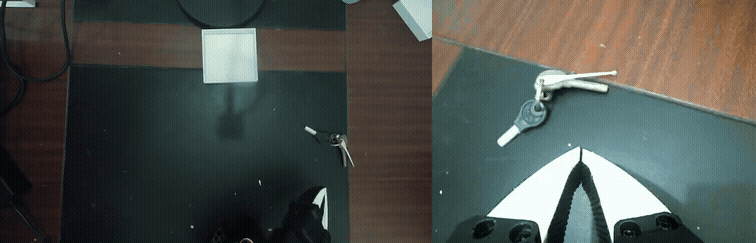

# SO-101 SmolVLA：真机抓取、数字孪生与离线策略改进

低成本 SO-101 双相机机械臂上的视觉语言动作模型项目。完成了真机数据采集、SmolVLA 全量微调、人工纠错与 RTC 推理，并构建了 MuJoCo + 3D Gaussian Splatting 数字孪生，用于脚本专家数据生成和 RECAP 风格离线策略改进实验。

**截至 2026-11-13，V5 是当前真机表现最好的版本。** 仿真和 RECAP 工作完整保留，但尚未验证出优于 V5 的真机效果。RK3588 部署探索保留在 `edge-rk3588` 分支；仓库名沿用原名。

## 真机成功演示

[](docs/media/v5-key-success.mp4)

[查看完整 MP4](docs/media/v5-key-success.mp4) · [导出来源](docs/media/v5-key-success.json)

V5，指令 `Put the key in the white box.`，RTC + Gaussian smoothing（sigma 2）。来自 2026-11-04 已逐段核验的真实测试 episode 1：完整视频约 16 秒、原速、无音频，左为顶视、右为腕部；动图为完整约 16 秒的原速预览。这是一段选取的成功案例，整体结果如下。

## 当前结果

| 模型 / 工作 | 已完成内容与结果 | 当前结论 |
|---|---|---|
| **V5 真机基线** | 玩偶 **17/21（81%）**；钥匙 **13/20（65%）**，其中钥匙左侧 4/10、右侧 9/10 | 当前推荐用于真机演示，仍有左右侧差异 |
| 数字孪生与数据 | 舵机辨识、相机/手眼标定、桌面纹理与连杆 3DGS；生成 **400 段**五类随机刚体抓放数据，合并 **840 段 / 455730 帧**真仿数据 | 数据流水线和闭环评测已打通 |
| RECAP v2 | 从 V5 微调 5000 步；critic 估值、优势标签、条件化策略训练 | 保留实验版本，未验证真机收益 |
| RECAP v3 | 从官方 base 微调 20000 步；真/仿 50:50，人工纠错帧 2 倍权重 | 未超过 V5；用户报告本轮钥匙仅 2/10 成功，且都在右侧 |
| 原始生成场景诊断 | v3 抽样训练集中心入盒 9/10、8/10；留出集均 3/10（分别执行 30/50 步） | 存在明显闭环泛化差距；详见报告 |

V5 数字来自同一历史测试协议下的录像核验；v3 的 2/10 是用户后续真机反馈，不是严格配对的统计对照。仿真中的“中心入盒”与“物体完整入盒”分别报告，不能混为同一成功标准。

## 技术工作

- **真机 VLA 与纠错**：LeRobot 数据录制/回放、双相机输入、SmolVLA 全量微调、静止段裁剪、人工接管数据与 RTC 动作衔接。
- **Real2Sim2Real**：相机和手眼标定、自动扫描、MuJoCo 舵机模型、桌面纹理/背景和机械臂连杆 3DGS、腕部夹爪图层合成。
- **仿真数据生成**：几何与接触约束脚本专家、五类随机不规则刚体、随机朝向/摆放/初始姿态、可控夹空重抓、LeRobot 格式转换和图像缓存。
- **离线策略改进探索**：201 类 Monte Carlo 价值预测、50 步优势估计、人工纠错/夹空标签覆盖、positive/negative 条件化模仿学习、真仿平衡采样及训练断点/网盘校验备份。这里没有实现 PPO/SAC 或在线策略梯度，不把离线动作误差当作抓取成功率。
- **诊断与评测**：本地双进程连接渲染/物理与策略推理；比较执行长度、训练/留出场景、原专家可解性、离线动作拟合和真机迁移差距。

## 文档与复现入口

- [当前项目状态、模型版本与数据流](docs/project-status.md)
- [常用命令：标定、采集、训练与真机测试](docs/commands.md)
- [V5 真机实验与评测口径](docs/experiments/exp4-full-v4.md) · [核验后的结果 CSV](docs/results/)
- [RECAP 实现、critic 与标签记录](docs/notes/recap.md)
- [v2/v3 仿真对比](docs/experiments/recap-v3-twin-eval.md) · [原始生成场景拟合诊断](docs/experiments/recap-v3-generated-fit.md)
- [硬件](docs/hardware.md) · [标定](docs/calibration.md) · [数字孪生方法与踩坑](docs/notes/real2sim2real-pitfalls.md)
- [计划与路线变更历史](docs/plan.md) · [早期仿真/DAgger 预研](docs/prestudy-sim/)

代码、配置、划分、代表性视频和轻量结果纳入 Git；模型权重、完整视频数据集、场景重建与大缓存保留在本地/服务器网盘，默认不上传 GitHub。完整复现需要自行采集或取得这些运行资产，不能仅克隆仓库即运行所有实验。

## 目录

| 路径 | 内容 |
|---|---|
| `so101vla/` | 正在使用的代码（下表） |
| `configs/` | 训练/数据配置；`configs/nexus/so101_nexus_env.json` 为 Nexus 场景参数（原随 HF 数据集 `johnsutor/MuJoCoPickAndPlace-v1` 下载） |
| `scripts/` | 分析与检查脚本 |
| `docs/` | 计划、仿真预研记录 |
| `reference/` | 原样归档、不维护的代码（RK3588 转换与板端、HAQ、量化；早期 SO101 探索；预研时的流水线脚本），见 [reference/README.md](reference/README.md) |
| `runs/`、`artifacts/` | 运行产物与模型/数据（Git 忽略）；`runs/qvla_rk3588/` 为 QVLA 中 smolvla_base 的 RK3588 转换与测速产物（`base_rk3588_speed_v1` 等，说明见 `reference/qvla_rk3588/docs/project-route.md` 末尾几节） |

## 代码（`so101vla/`）

| 模块 | QVLA 中的原文件 | 作用 |
|---|---|---|
| `paths.py` | `qvla/evaluation/so101_paths.py` | Nexus 源码路径（`SO101_NEXUS_SOURCE`） |
| `expert.py` | `so101_scripted_expert.py` | 仿真环境与读取真值的脚本专家（状态机 + IK） |
| `generate_data.py` | `generate_so101_scripted_data.py` | 生成示教数据（含特权标签） |
| `verify_data.py`、`check_labels.py` | `verify_so101_scripted_data.py`、`check_so101_privileged_labels.py` | 数据校验 |
| `train.py` | `finetune_so100_real.py` | SmolVLA 微调训练器（含 LeRobot 真机数据 prepare；`--resume`、`--stop-step`） |
| `scripted.py` | `finetune_so101_scripted.py` | 仿真数据读取、prepare、闭环评测（`--trace`） |
| `dagger.py` | `collect_so101_dagger.py` | DAgger：策略驾驶、专家接管打标签、目标标注 |
| `chain_eval.py` | `so101_chain_eval.py` | 链式长任务评测 |
| `diagnose_fit.py` | `diagnose_so101_scripted_fit.py` | 训练/验证拟合诊断 |
| `goal.py`、`goal_eval.py`、`check_goal.py` | `so101_goal.py`、`so101_goal_eval.py`、`check_so101_goal.py` | 目标条件化结构（已暂停，保留用于复现） |
| `advantage.py`、`value.py` | 本项目新增 | RECAP 条件化策略、Monte Carlo critic 与优势标签 |
| `recap_sampling.py` | 本项目新增 | 真仿平衡采样、纠错帧加权与缓存核验复用 |
| `rollout.py` | 本项目封装 | 真机加载与 RTC 衔接/平滑修正 |
| `policy.py` | `haq_offline_eval.load_policy`（仅普通 checkpoint） | 加载 SmolVLA 与处理器 |

预研文档中的路径（`qvla/evaluation/...`、`config/...`、`runs/...`）指 QVLA 中的旧位置，对应关系见上表。

## 环境

用 uv 管理：Python 3.12（uv 自带解释器），依赖在 `pyproject.toml`，锁定在 `uv.lock`（torch 2.7.1+cu118 来自 PyTorch cu118 源；lerobot 0.6.1 含 smolvla/dataset/feetech；mujoco 3.8.1；numpy 2.2.6）。

```bash
uv sync   # 按 uv.lock 建立/更新 .venv
export MUJOCO_GL=egl SO101_NEXUS_SOURCE=/home/loser/Study/so101-nexus   # Nexus @ 7bdb671，从源码导入，不安装
uv run python -m so101vla.generate_data --config configs/so101_scripted_data_v2.json
uv run python -m so101vla.train --config configs/so101_scripted_full_v2.json --stage prepare
uv run python -m so101vla.scripted --config configs/so101_scripted_full_v2.json --model-dir <checkpoint> --output runs/eval_x --execute 10 --stop-on-success
```

加依赖用 `uv add <包>`（会同时更新 `pyproject.toml` 与 `uv.lock`）。LeRobot 命令（`lerobot-find-port`、`lerobot-calibrate`、`lerobot-teleoperate`、`lerobot-record`、`lerobot-train` 等）用 `uv run lerobot-...` 调用，不另建 LeRobot 环境。

系统 FFmpeg 为 9.x，torchcodec 0.11 只支持 FFmpeg 4–8、加载失败，LeRobot 自动退回 pyav 解码（录制编码本来就用 pyav），功能正常，仅解码较慢；2026-10-21 实测本地 `svla_so100_pickplace` 经 pyav 正常读取。RKNN-Toolkit2 等与上面版本冲突的工具链单独建环境（端侧支线用的 `.venv-rknn`，说明在分支 `edge-rk3588` 的 `docs/commands.md` 第 11 节）。

仿真预研的模型与数据已删除（2026-10-19），`runs/so101_*`、`runs/so100_*` 只保留文本结果，见 [docs/prestudy-sim/so101-artifacts.md](docs/prestudy-sim/so101-artifacts.md)。

基础模型 `artifacts/smolvla_base`（`lerobot/smolvla_base`）与 VLM 资源 `artifacts/transfer/smolvlm2_assets` 需放在 `artifacts/` 下。


数字孪生渲染另用 `.venv-gs`，依赖编译后的 gsplat/CUDA，配置方法和已用版本见 [重建环境记录](docs/notes/real2sim2real-pitfalls.md)。它不替换主训练环境；本地闭环评测通过无损图像管道调用主环境策略。当前训练和生成入口见 [项目状态](docs/project-status.md)。
