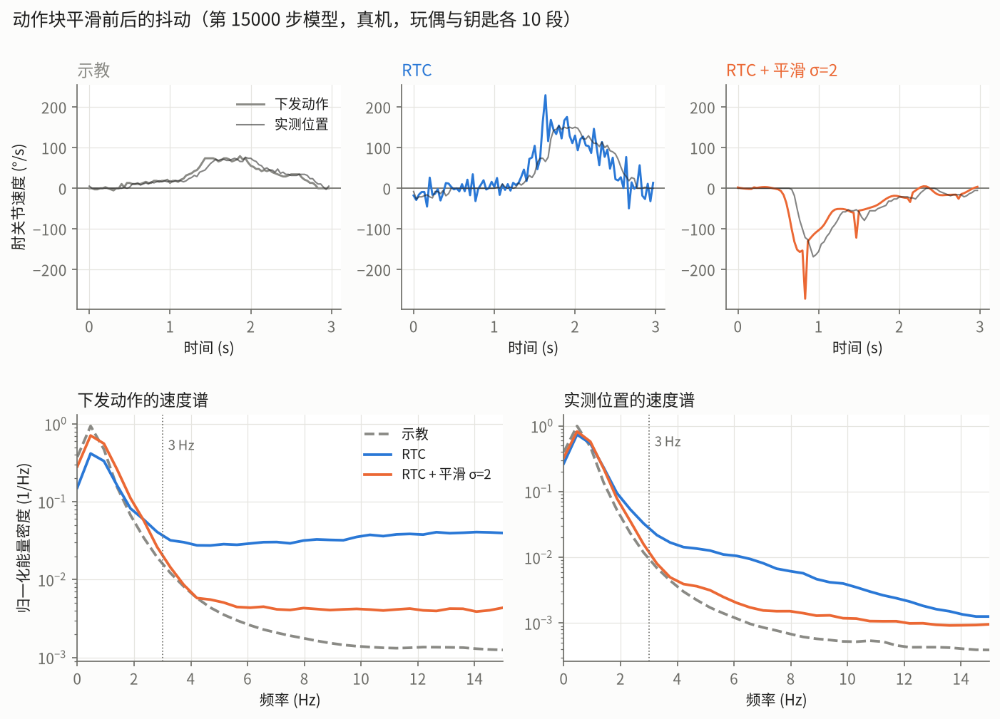

# 动作块平滑（抖动）

开了 RTC 以后机械臂还是会抖。下面先确认抖动来自哪里，再离线比较几种平滑方法。最后用真机录像量化比较平滑前后（见最后一节）。

## 抖动来自模型输出

用 `scripts/jitter_analysis.py` 统计两组数据：一组是示教数据，一组是真机测试录像。每组都分别统计下发的动作（`action`）和舵机实测位置（`observation.state`）。指标是每个关节每秒的"方向反转"次数：相邻两步变化方向相反，且两步都大于 0.2°，算一次反转。下表给的是 5 个臂关节的范围，不含夹爪。

| 数据 | 动作 反转/秒 | 实测位置 反转/秒 |
|---|---|---|
| 示教（`so101_pilot_v2`，遥操作） | 0.00–0.02 | 0.00–0.02 |
| 实验一 同步（`rollout_key_v1_best`） | 10.6–15.1 | 0.5–2.5 |
| 实验二第 6500 步 同步（玩偶） | 8.6–13.3 | 0.5–1.7 |
| 实验二第 6500 步 RTC 视野 10（玩偶） | 8.2–12.9 | 0.4–0.8 |
| 实验二第 15000 步 RTC 视野 20（玩偶） | 3.6–7.1 | 0.1–0.2 |
| 实验二第 15000 步 RTC 视野 20（钥匙） | 4.4–8.8 | 0.04–0.12 |

- 示教动作几乎没有来回反转，模型下发的动作每秒反转好几次。所以抖动来自模型输出的动作块本身：块内相邻步之间来回锯齿。舵机只能滤掉一部分。
- 高频幅度看同一个结论：动作减去 0.3 s 滑动平均后的 RMS，示教为 0.25–0.56°，第 15000 步 RTC 为 0.3–1.1°。舵机实测位置的高频幅度（0.2–0.8°）也比示教（0.2–0.45°）大。
- 训练更久、改用 RTC 以后，抖动都变小了，但没有消失。

## 离线比较

用 `scripts/smoothing_offline.py` 比较。模型是第 15000 步的 best，在 11 个验证段上共取 110 个观测，每个观测固定一个噪声种子，预测一个 50 步的动作块，然后对块内的时间轴做平滑。指标都取 5 个臂关节的平均：

| 方法 | 块内反转/秒 | 高频 RMS | 与录制动作的归一化误差 | 第一步被移动（各关节最大值的中位数） |
|---|---|---|---|---|
| 原始输出（去噪 10 步，默认） | 6.48 | 0.61° | 0.2756 | — |
| 去噪 20 步 | 6.22 | 0.61° | 0.2759 | — |
| 高斯 σ=1 | 0.13 | 0.42° | 0.2750 | 0.49° |
| **高斯 σ=2** | **0.01** | 0.30° | 0.2743 | 0.84° |
| 高斯 σ=3 | 0.00 | 0.23° | 0.2735 | 1.18° |
| Savitzky–Golay 窗口 9 / 2 阶 | 0.11 | 0.40° | 0.2752 | 0.60° |
| Savitzky–Golay 窗口 15 / 2 阶 | 0.02 | 0.31° | 0.2750 | 0.83° |
| 录制动作（参照） | 0.01 | | | |

- 增加去噪步数没有改善，说明锯齿不是因为采样步数太少。
- 平滑后误差不升反降。说明被滤掉的是噪声，不是真实动作。
- 高斯 σ=2（半径 6 步，约 0.2 s）能把反转次数降到和示教一样。它把块的第一步移动约 0.8°。用 RTC 时，新块开头约 9 步本来就会被丢掉，所以影响不大。σ=3 的误差更低，但第一步被移动得更多。
- 这里的平滑只对已经预测出来的整块动作做，用的都是模型已经规划好的未来动作，所以不会像实时滤波那样带来滞后。块的两端用边缘值填充。

## 实现

`so101vla/rollout.py` 包装了 `lerobot-rollout`，增加一个 `--smooth_sigma` 参数。它替换 `SmolVLAPolicy._get_action_chunk`，同步和 RTC 推理都经过这个函数，替换后会对每个输出块做高斯平滑。平滑在归一化空间进行；因为滤波是线性的、权重和为 1，结果和在关节角度上平滑相同。

`eval.fish` 和 `try.fish` 加了 `--smooth σ`。2026-10-23 起默认 σ=2，`--smooth 0` 关闭；开了以后，CSV 的 note 列会写成 `rtc+smooth2`。已做的验证：
- torch 实现和离线 numpy 滤波相差 1.5e-6；
- 在 GPU 上，打补丁后 `predict_action_chunk` 的输出与"原始输出再平滑"完全相同；
- 用假串口确认 RTC 的参数能被正常接受。

## 真机试用（2026-10-23 中午）

用户用 `try.fish --rtc --smooth 2`（第 15000 步模型）在真机上试了一次，没有录像。用户观察："平滑了不少，减少了很多抖动"。

**正式测试（14:00 左右）**：用 `eval.fish ... --rtc --smooth 2` 两个任务各测 10 段，成功率玩偶 5/10（不平滑 6/10）、钥匙 3/10（不平滑 3/10）。每个任务只有 10 段，成功率看不出差别。用户观察：抖动明显减少，实际效果感觉更好一些。量化对比见下一节。结论：以后真机测试默认加 `--smooth 2`。

## 平滑前后的量化对比

**数据**：第 15000 步模型（`runs/so101_pilot_v2/best/`）的真机录像，RTC 不平滑（`rollout_pilot_v2_final_{doll,key}_rtc`）和 RTC + σ=2（`..._rtc_s2`）。玩偶和钥匙各 10 段，四组分别有 7773、8334、10077、10802 帧。不是同一批初始摆放，所以比较的是整体统计，不是逐段配对。示教数据 `so101_pilot_v2`（遥操作）作为"平滑运动"的参照。

**指标**：每个关节单独算，所有段合并后再取 5 个臂关节的平均（不含夹爪）。`action` 是下发给舵机的目标角，`state` 是舵机实测到达的位置。

| 指标 | 怎么算 | 含义 |
|---|---|---|
| 反转/秒 | 相邻两步方向相反、且两步都 > 0.2°，记一次；除以时长 | 每秒来回抖几下，最直观 |
| ≥3 Hz 能量占比 | 把每帧变化量（速度）做傅里叶变换，算 3 Hz 以上的能量占总能量的比例 | 运动里"抖"的成分占多少。示教动作 97.7% 的能量在 3 Hz 以下，所以取 3 Hz 为界。换成 2、5、8 Hz，平滑前后的差距同样明显 |
| jerk RMS | 位置三阶差分 × 30³ 的均方根（°/s³） | 运动平滑性研究里常用的"加加速度"。位置读数的最小刻度是 0.088°（4096 格/圈），三阶差分会把这种量化误差放大，所以实测位置的 jerk 本底较高，示教约 4500 |
| 高频 RMS | 位置减去 0.3 s 滑动平均后的 RMS（°） | 前面用过的指标，但会把正常运动的弯曲一起算进去，不适合单独衡量抖动 |

计算：`uv run --frozen python scripts/jitter_analysis.py artifacts/datasets/{so101_pilot_v2,rollout_pilot_v2_final_doll_rtc,rollout_pilot_v2_final_doll_rtc_s2,rollout_pilot_v2_final_key_rtc,rollout_pilot_v2_final_key_rtc_s2}`（输出每个关节的值）。

**下发动作**（模型输出、平滑直接作用的对象）：

| 指标（5 个臂关节平均） | 示教 | 玩偶 RTC | 玩偶 + 平滑 | 变化 | 钥匙 RTC | 钥匙 + 平滑 | 变化 |
|---|---|---|---|---|---|---|---|
| 反转/秒 | 0.014 | 5.70 | 0.052 | −99% | 6.90 | 0.024 | −99.7% |
| ≥3 Hz 能量占比 | 0.030 | 0.311 | 0.043 | −86% | 0.523 | 0.044 | −92% |
| jerk RMS (°/s³) | 7700 | 48800 | 14100 | −71% | 44200 | 8590 | −81% |
| 高频 RMS (°) | 0.42 | 0.79 | 0.55 | −30% | 0.56 | 0.35 | −37% |

**实测位置**（机械臂实际怎么动）：

| 指标（5 个臂关节平均） | 示教 | 玩偶 RTC | 玩偶 + 平滑 | 变化 | 钥匙 RTC | 钥匙 + 平滑 | 变化 |
|---|---|---|---|---|---|---|---|
| 反转/秒 | 0.006 | 0.142 | 0.012 | −92% | 0.082 | 0 | −100% |
| ≥3 Hz 能量占比 | 0.014 | 0.067 | 0.021 | −68% | 0.125 | 0.039 | −69% |
| jerk RMS (°/s³) | 4500 | 11100 | 6790 | −39% | 9540 | 5840 | −39% |
| 高频 RMS (°) | 0.37 | 0.55 | 0.47 | −16% | 0.37 | 0.31 | −15% |

图由 `uv run --frozen --with matplotlib python scripts/smoothing_plot.py` 生成。上排是每组第 0 段里运动最大的 3 s 内肘关节的速度，三栏纵轴相同；下排是 5 个臂关节的速度谱，玩偶和钥匙两个任务的数据合并在一起，每条曲线都归一化到总能量为 1。

- 下发动作：平滑前每秒来回反转 6 次左右，3 Hz 以上的能量占 31–52%；平滑后反转几乎为 0，高频占比约 4%，接近示教的 3%。速度曲线从逐帧锯齿变成平顺的曲线。
- 实测位置：舵机本身会滤掉一部分抖动，所以平滑前的数值就比下发动作小。平滑后，高频占比降低约 2/3，jerk 降低约 40%，实测反转从每秒约 0.1 次降到接近 0。
- 平滑后仍比示教略高：图中橙色速度曲线还有孤立的尖峰，位置看起来是新旧动作块衔接的地方；第 2、3 关节平滑后的实测 jerk（9000 左右）也仍是示教的 2 倍。这部分可能来自块与块之间的跳变，块内平滑处理不到。是否确实如此，还没有验证。
- 高频 RMS 只降了 15–37%，因为它把正常的运动弯曲也算了进去。衡量抖动时，应该看反转/秒和高频能量占比。
