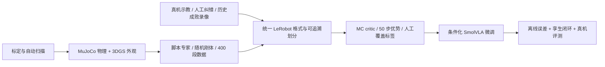

# 当前项目状态与复现入口

更新：2026-11-13。当前真机推荐模型为 **`runs/so101_full_v5/best`**。仿真、critic 与 RECAP 保留为完整实验路线，当前没有验证出对 V5 的真机收益。仓库用于保存代码、配置、结果和代表性演示，权重与完整数据仍位于本地和服务器网盘。

## 模型与结果

| 版本 | 初始化与数据 | 实际完成内容 | 当前状态 |
|---|---|---|---|
| V5 | 真机示教/人工纠错，延续 V4 | 全量微调、RTC 真机测试 | 当前最佳；历史录像核验玩偶 17/21，钥匙 13/20（左 4/10、右 9/10） |
| RECAP v1 | 原计划从 V5 初始化；540 段数据 | 数据合并、critic v1 训练和标签完成 | 没有找到可测试的 v1 策略权重；不要把 critic 当抓取策略 |
| RECAP v2 | V5；840 段 / 455730 帧，含 400 段孪生 | 使用 critic v1 估值和重新计算的优势标签训练 5000 步，已下载本地 | 实验保留，未验证真机提升 |
| RECAP v3 | 官方 SmolVLA base；沿用 v2 数据/标签 | 20000 步，LR 峰值 1e-4，真/仿 50:50，人工纠错帧 2 倍权重 | best 19000 步；用户反馈钥匙 2/10，成功均在右侧；未替代 V5 |

V5 的详细口径与已知问题见 [实验四](experiments/exp4-full-v4.md)，核验后的历史标注保存在 [results](results/)。V3 的真机数字来自用户反馈，不含未经提供的逐段左右标签，也没有声称与 V5 是同一批摆放下的统计对照。

## 数据和实现索引



| 部分 | 入口 |
|---|---|
| 真机采集、人工纠错、训练与 RTC | `scripts/record.fish`、`scripts/eval.fish`、`scripts/dagger.fish`（若使用纠错流程，见 commands）、`so101vla/train.py`、`so101vla/rollout.py` |
| 标定、舵机辨识、扫描、场景重建 | [标定](calibration.md)、[重建方法与命令](notes/real2sim2real-pitfalls.md) |
| 物理/外观与原轨迹回放 | `scripts/twin_scene.py`、`twin_render.py`、`twin_replay.py`、`twin_compare.py` |
| 随机物体与几何脚本专家 | `scripts/twin_shapes.py`、`twin_expert.py`、`twin_generate.py` |
| 生成数据转 LeRobot、压缩、标签侧车 | `scripts/twin_to_lerobot.py`、`shrink_videos.py`、`recap_extend.py` |
| 真机数据合并、value 与 advantage 标签 | `scripts/recap_dataset.py`、`so101vla/value.py`、`so101vla/advantage.py` |
| 平衡采样、纠错帧加权、缓存复用 | `so101vla/recap_sampling.py` |
| 断点、上传、备份校验与历史运行脚本 | `scripts/recap_prepare_v2.py`、`train_with_backup.py`；`twin_night_v2.sh`、`twin_topup_v2.sh` 是当时的批任务配置，不是通用一键启动器 |
| 本地模型闭环及原专家观测下的拟合 | `scripts/twin_policy_eval.py`，支持 `--cases-json`、`--teacher-forced-stats` |
| README 视频导出 | `scripts/export_readme_demo.py`；逐段读取元数据和成功 CSV，不连接机械臂 |

脚本专家使用物体真值做几何规划；部署策略只接收相机、任务文本与关节状态，不能把脚本专家的完成率算成策略完成率。

## 复现前置条件

主环境用 `uv sync --frozen`，详见 README。渲染使用独立 `.venv-gs`；gsplat、torch 与本机 CUDA 编译版本需匹配，已用版本与安装步骤见 [环境记录](notes/real2sim2real-pitfalls.md)。

运行资产包括：SmolVLA base/VLM tokenizer、本地模型、LeRobot 数据、标定结果、舵机辨识文件、工作台/机械臂 3DGS 与盒子模型。它们被 `/runs/`、`/artifacts/` 忽略，不能仅靠克隆代码完成所有训练。配置保留实验原始路径，例如 `/root/sj-fs`、`/dev/shm`；其他机器需要调整路径、显存和缓存空间。`recap_prepare_v2.py` 的 SSH 别名/项目根目录也是原实验设置。

有场景资产时，先在新目录生成预览和少量数据：

```bash
.venv-gs/bin/python scripts/twin_generate.py --preview --seed 3 --out runs/twin/new_preview
.venv-gs/bin/python scripts/twin_generate.py --episodes 10 --seed 9000 \
  --random-start --wide --regrasp 0.0 --out runs/twin/new_generated
.venv/bin/python scripts/twin_to_lerobot.py --generated runs/twin/new_generated \
  --like artifacts/datasets/so101_twin_keytied_day --out artifacts/datasets/new_generated
```

`--regrasp 0.0` 表示干净成功专家轨迹，`--regrasp 0.3` 是历史故意失败数据实验，不是推荐改进。现有训练配置、数据划分和已完成步骤见 [RECAP 记录](notes/recap.md)；原批任务应结合已有资产与产物状态复现，不覆盖已完成 run。

价值函数与策略的命令接口：

```bash
.venv/bin/python -m so101vla.value --config configs/so101_value_v1.json --stage prepare
.venv/bin/python -m so101vla.value --config configs/so101_value_v1.json --stage smoke
.venv/bin/python -m so101vla.value --config configs/so101_value_v1.json --stage train
.venv/bin/python -m so101vla.value --config configs/so101_value_v1.json --stage label
# v2 标签需要对应完整合并数据及 critic v1，见 configs/so101_value_v2_labels.json。
.venv/bin/python -m so101vla.train --config configs/so101_recap_v2.json --stage prepare
.venv/bin/python -m so101vla.train --config configs/so101_recap_v2.json --stage smoke
.venv/bin/python -m so101vla.train --config configs/so101_recap_v2.json --stage train
```

这些是训练接口示例，执行前必须准备所引用的数据与标签，并使用独立输出目录。v3 的 prepare 还会读取 v2 的已核验缓存；完整设置见 [v3 配方](experiments/recap-v3-base-balanced.md)。

V5 钥匙真机测试（摆好设备和物体后在交互终端执行，会启动机械臂运动）：

```bash
fish scripts/eval.fish -n rollout_v5_key_new_test \
  -p runs/so101_full_v5/best -t 'Put the key in the white box.' -e 10 -s 60 --rtc
```

## 已验证的限制

- 原始生成场景按形状/左右分层抽样，训练/验证各 10 段，30/50 步两种执行长度共 40 次；训练集中心入盒为 9/10、8/10，验证集均为 3/10。离线动作 MAE 分别约 0.097、0.134，低误差不代表闭环成功。[原始场景报告](experiments/recap-v3-generated-fit.md)
- 原专家按原中心入盒标准 20/20 成功，但按所有顶点 XY 位于盒内的较严格标准仅 6/20；有些示教本身允许露出盒沿。
- 新长方体代理场景的 v3 完整入盒计数有所改善，但受颜色、摆放和执行长度影响。[v2/v3 对比](experiments/recap-v3-twin-eval.md)
- 故意夹空共 88 段、14676 帧，全部标为 negative，但仍参与条件化动作模仿，且存在 30% 标签 dropout。影响尚未用剔除失败动作的消融验证，不能确定是真机退步的唯一原因。
- critic v1 出现训练/留出差距，v2/v3 均没有重训 critic；其价值预测准确度不是机器人任务成功率。这里是 RECAP 风格离线改进探索，没有 PPO/SAC、在线 actor-critic 联合更新或已证实的 RL 性能收益。
- 渲染存在阴影/光照、纯色物体、腕部遮挡层和真实黑色物体覆盖方面的差距；同步仿真不包含 RTC 异步推理延迟。

后续优先做同布局配对评测、剔除故意夹空动作的消融、成功判据与示教质量修正；本次归档没有启动新训练或修改模型。
